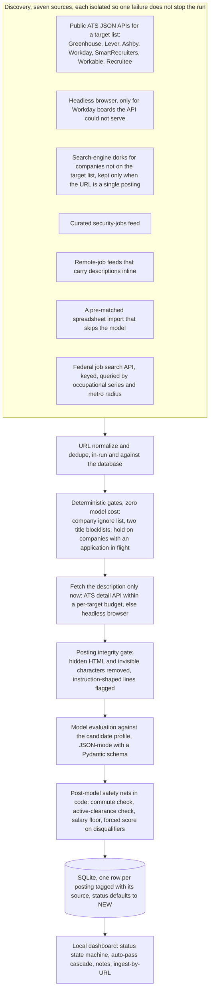
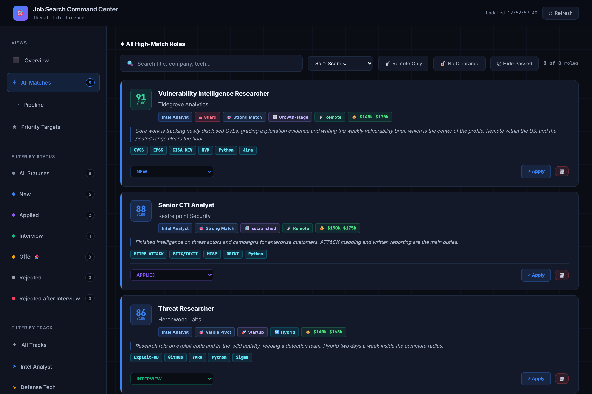

# job-meets-resume

A personal job-discovery pipeline that scores job postings against one resume. It ranks postings and never edits the resume. The name is a play on dating apps: most postings are turned down by deterministic gates before they ever meet the model.

**This repository is a showcase, not the source.** It documents the architecture and the engineering behind a system I run daily, and includes the infrastructure modules that stand on their own. The evaluation prompt, the candidate profile it scores against, the target list and the data are private. I designed the pipeline and directed AI coding tools to build and debug much of it, and I am happy to discuss the architecture and the engineering decisions behind it.

## Pipeline at a glance



The ordering is the point. Everything cheap and deterministic runs before anything expensive and probabilistic, and the model's answer is checked by code before it is written down.

## The triage dashboard




These screenshots come from a demo copy of the dashboard filled with fictional companies and postings. In that copy a personal log and two retired track filters are hidden from the sidebar, and the subtitle no longer names a track the search has since dropped. The top posting carries the Guard tag: its page hid an instruction addressed to the evaluator, which the posting guard removed before scoring.

## What it has done

- Over 8,000 postings processed since June 2026.
- 64 percent of those were decided by the deterministic gates (the row's stored reason says which gate) and never reached a model call.
- Roughly one to two cents per model evaluation on a Flash-class model, with a stable 12,000-token prefix the provider caches.
- Runs need no supervision once started: a stopped run resumes where it ended, because every row is committed as it is scored.

## Engineering highlights

**Gates before models.** A posting from a company on the ignore list, with a non-technical title, or at a company with an application already in flight is decided in microseconds and logged so it is never fetched again. The hold is the subtle one: it skips without logging, so those postings come back on their own when the application concludes. See [`docs/status-model.md`](docs/status-model.md).

**A posting is untrusted input.** Anyone who controls a careers page can write text for the evaluator rather than for a reader. [`engineering/posting_guard.py`](engineering/posting_guard.py) strips hidden elements and invisible characters before any model sees the text, and flags instruction-shaped lines, invisible characters inside words and mixed-script words. Flagged postings are still scored, on the cleaned text, with a stamp the dashboard shows. A live sweep of 210 real postings produced zero false flags after one pattern was tightened. Design notes in [`docs/integrity-gate.md`](docs/integrity-gate.md).

**Structured output, then code.** The model answers a Pydantic schema, never prose ([`engineering/schema.py`](engineering/schema.py)). Gaps are typed by time-to-close rather than subject. Salary estimates are display-only and can never trip the salary gate. The commute and salary rules are re-applied in code after the model answers, because a model that extracted the right location and then forgot to set the flag was a real failure. A clearance the applicant must already hold is its own boolean beside the free-text clearance field, so the check in code reads a flag rather than parsing prose. See [`docs/evaluation.md`](docs/evaluation.md).

**Every row records its source.** The discovery phase that found a posting is stored with it, so a source earns its place by what it produced (rows, high scores, applications, interviews) rather than by how many postings it returns.

**One application per company, enforced on both surfaces.** A single token-prefix company matcher ([`engineering/company_match.py`](engineering/company_match.py)) serves the pipeline's hold gate and the dashboard's cascade, so "Acme" matches "Acme Ltd" everywhere and "Nova" never matches "Supernova" anywhere.

**Seven ATS integrations, one contract.** Each provider returns the same normalized job dict and raises on failure so one bad board cannot take down the phase. Workday is the awkward one: an undocumented JSON API, a page cap of 20, site ids that differ from the public URL, and a detail call per description. [`engineering/ats_client.py`](engineering/ats_client.py) shows the probing, the detail budget and the content-type guard.

**Failure classes, not retries.** The model fallback chain distinguishes a quota hit, a retired model and a depleted prepaid balance, because an unattended run needs to stop for one of those and keep going for the others ([`engineering/model_fallback.py`](engineering/model_fallback.py)).

**Scraper hygiene.** URL normalization strips trackers so the same job from three sources counts once and refuses non-web schemes so a stored link cannot become an XSS sink; an SSRF guard resolves every browser fetch target before the page is opened; ATS API hosts come from configuration ([`engineering/url_safety.py`](engineering/url_safety.py)).

## What is withheld, and why

| Withheld | Reason |
|---|---|
| The evaluation prompt and scoring rubric | The calibrated judgment is the value of the system |
| The candidate profile, upskilling plan and target company list | Personal |
| The database, dashboard code and application history | Personal; outcomes are not a benchmark of the pipeline |
| Gate lists: ignored companies, title blocklists, commute keywords, salary floor | Encode one person's search |
| Resume tooling that sits beside the pipeline | Personal documents |

## Repository layout

```
README.md
docs/
  architecture.md      components, phases, data flow, the cost model
  evaluation.md        how scoring works and what code checks after the model
  integrity-gate.md    the posting guard: what it removes, what it flags, what it ignores
  status-model.md      the application state machine and the auto-pass cascade
  images/              dashboard screenshots from a demo database of fictional postings
engineering/
  posting_guard.py     complete module with an offline self-test (python posting_guard.py --selftest)
  company_match.py     complete module
  schema.py            the structured-output contract, generalized
  model_fallback.py    fallback chain with the three-way error taxonomy, runnable demo
  ats_client.py        the Workday client excerpt
  url_safety.py        URL normalization and the SSRF guard
```

The private pipeline runs on Python 3.14 with Playwright, BeautifulSoup, Pydantic and the Gemini API. The excerpts here need only what `requirements.txt` lists.

## License

MIT. The excerpts are free to reuse. The names of ATS vendors and model providers are theirs.
