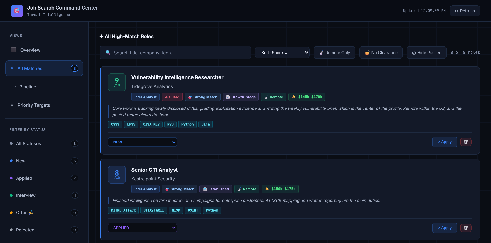
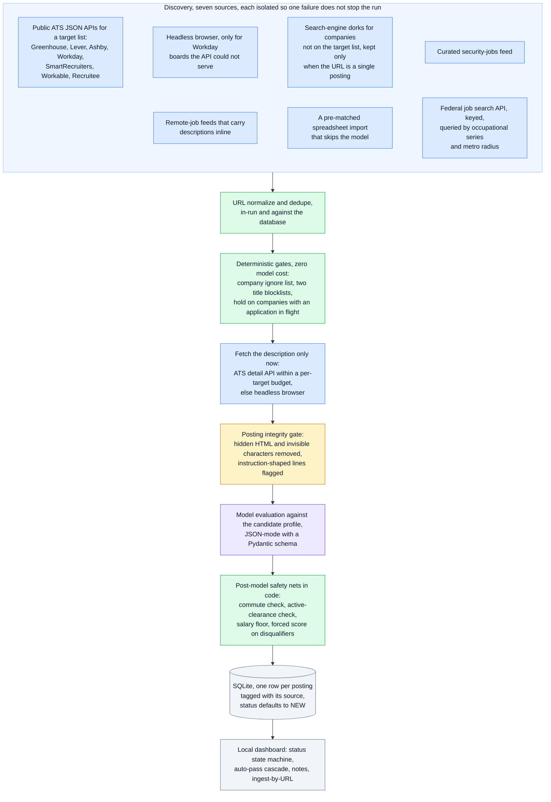
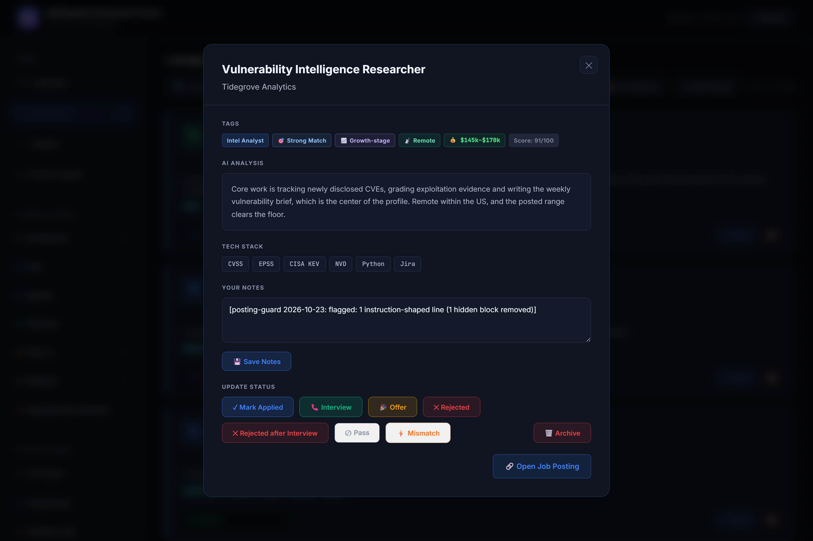
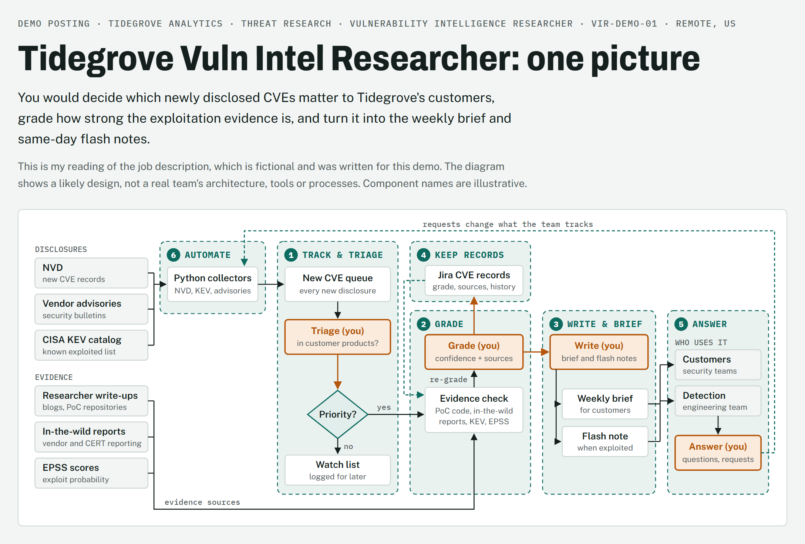

# job-meets-resume

  

A personal job-discovery pipeline that scores job postings against one resume. The pipeline ranks postings and never edits the resume. Tailoring is a separate chat-side step, taken one posting at a time, that writes a new file and leaves the master resume untouched. The name is a play on dating apps: most postings are turned down by deterministic gates before they ever meet the model.



*Demo data: the triage dashboard running on fictional companies and postings; see the note under [The triage dashboard](#the-triage-dashboard-demo-data).*

**This repository is a showcase, not the source.** It documents the architecture and the engineering behind a system I run daily, and includes the infrastructure modules that stand on their own. What stays private, and why, is listed under [What is withheld](#what-is-withheld-and-why). I designed the pipeline and directed AI coding tools to build and debug much of it, and I am happy to discuss the architecture and the engineering decisions behind it.

| 8,000+ | 64% | 1 to 2 cents |
|:---:|:---:|:---:|
| postings processed since June 2026 | decided by deterministic gates, never reaching a model call | per model evaluation on a Flash-class model, with a cached 12,000-token prefix |

## Pipeline at a glance



Blue: discovery and fetching. Green: deterministic code, no model cost. Amber: the integrity gate. Purple: the one model call. Gray: storage and the dashboard.

The ordering is the point. Everything cheap and deterministic runs before anything expensive and probabilistic, and the model's answer is checked by code before it is written down.

## How it runs

The system has two halves. The pipeline runs unattended from the command line, fills the database and feeds the triage dashboard. The chat side runs in Claude Code, one posting at a time, once a posting looks worth a closer read.

### Pipeline commands

| Command | What it does |
|---|---|
| `job_search.py run` | One full pass: discovery from every source, the gates, the integrity check, model scoring and the database write. A stopped run resumes where it ended, because each row is committed as it is scored. |
| `job_search.py run --dry-run` | Discovery only, for testing a new source or query: no model calls and no database writes. |
| `job_search.py ingest <url>` | Scores one posting found by hand. It skips the ignore list and the title blocklists, since a person already chose the posting, and only warns when an application at that company is in flight. `--force` re-scores an existing row, and `--remote` or `--location` record a location the operator has checked in place of the geo check. |
| `job_search.py sources` | Reports rows, high scores, applications and interviews for each discovery source. |
| `dashboard_server.py` | Serves the local triage dashboard shown below. |

### The triage dashboard (demo data)

> [!NOTE]
> **Demo data.** Every company, posting, score and status in the screenshots on this page is fictional. The dashboard images come from a demo copy of the dashboard, in which a personal log and two retired track filters are hidden from the sidebar and the subtitle no longer names a track the search has since dropped.



*Demo data: one posting opened.*

This is the Tidegrove Analytics posting from the screenshot at the top of the page. It carries the Guard tag: its page hid an instruction addressed to the evaluator, which the posting guard removed before scoring.

### Chat-side skills

A posting that survives triage moves to the chat side.

| Step | What it does | What it never does |
|---|---|---|
| Evaluate a pasted posting | The interactive deep read of one role, whether the pipeline found it or it came from elsewhere. Classifies the role, matches its requirements against the master resume, lists gaps and missing keywords, checks commute and pay, and returns one fit verdict. | Present an estimate as fact: a salary the posting does not state is labeled as an estimate. |
| `/decode` | Expands each responsibility into the day-to-day work it implies, then ranks them from strongest to weakest match, so an interview can be steered toward the strong ones. | Describe the candidate's experience in the posting's vocabulary instead of the resume's own. |
| `/tailor` | Writes a separate tailored resume from the master resume alone and lists every change for the candidate to veto. It starts on its own after a strong verdict, or on request. Each bullet keeps a provenance entry: the exact master-resume quote behind it and one sentence to defend it in an interview. | Edit the master or default resume, invent experience, inflate depth, swap the resume's terms for the posting's, or keep a keyword the master resume cannot support. Unsupported keywords are listed as rejected instead. |
| `/trace` | Re-checks a tailored resume bullet by bullet against the master resume: the master quote that supports each claim, any integrity flag (such as experimental work presented as production, or a term swapped toward the posting), and one honest sentence for the interview. A script runs the same audit offline and confirms every quote appears word for word in the master. | Accept a citation that is not an exact quote from the master resume. |
| `/job-picture` | Draws the role as one diagram from the posting alone: inputs on the left, the posting's responsibilities as numbered zones, consumers on the right, and the points where the hire makes decisions. | Read a resume, or present the diagram as knowledge of the team's real system. |
| `/mock`, `/cover`, `/review` | Runs mock interview rounds, drafts a cover letter, and checks a draft for repetition and formatting. | Put salary or home location into anything an employer will read. |



*Demo data: `/job-picture` drawn from [a fictional posting](docs/demo/tidegrove-posting.md) written for this demo, for the Tidegrove Analytics role opened in the dashboard above. Orange marks where the analyst decides; dashed teal lines are loops.*

## Engineering highlights

**Gates before models.** A posting from a company on the ignore list, with a non-technical title, or at a company with an application already in flight is decided in microseconds and logged so it is never fetched again. The hold is the subtle one: it skips without logging, so those postings come back on their own when the application concludes. See [`docs/status-model.md`](docs/status-model.md).

**A posting is untrusted input.** Anyone who controls a careers page can write text for the evaluator rather than for a reader. [`engineering/posting_guard.py`](engineering/posting_guard.py) strips hidden elements and invisible characters before any model sees the text, and flags instruction-shaped lines, invisible characters inside words and mixed-script words. Flagged postings are still scored, on the cleaned text, with a stamp the dashboard shows. A live sweep of 210 real postings produced zero false flags after one pattern was tightened. The module is adapted from `tools/posting_guard.py` in [ai-job-search](https://github.com/ai-job-search-dev/ai-job-search) (MIT) and rewritten for a pipeline that only scores postings, with retuned patterns. Design notes in [`docs/integrity-gate.md`](docs/integrity-gate.md).

**Structured output, then code.** The model answers a Pydantic schema, never prose ([`engineering/schema.py`](engineering/schema.py)). Gaps are typed by time-to-close rather than subject. Salary estimates are display-only and can never trip the salary gate. The commute and salary rules are re-applied in code after the model answers, because real rows came back with an out-of-area city in `true_location` and `geo_disqualified` still false. A clearance the applicant must already hold is its own boolean beside the free-text clearance field, so the check in code reads a flag rather than parsing prose. See [`docs/evaluation.md`](docs/evaluation.md).

**Every row records its source.** The discovery phase that found a posting is stored with it, so a source earns its place by what it produced (rows, high scores, applications, interviews) rather than by how many postings it returns.

**One application per company, enforced on both surfaces.** A single token-prefix company matcher ([`engineering/company_match.py`](engineering/company_match.py)) serves the pipeline's hold gate and the dashboard's cascade, so "Acme" matches "Acme Ltd" everywhere and "Nova" never matches "Supernova" anywhere.

**Seven ATS integrations, one contract.** Each provider returns the same normalized job dict and raises on failure so one bad board cannot take down the phase. Workday is the awkward one: an undocumented JSON API, a page cap of 20, site ids that differ from the public URL, and a detail call per description. [`engineering/ats_client.py`](engineering/ats_client.py) shows the probing, the detail budget and the content-type guard.

**Failure classes, not retries.** The model fallback chain tells a quota hit, a retired model and a depleted prepaid balance apart. The first two step to the next model. The third stops the run at once, because every model draws on the same balance and cascading would only print misleading quota errors ([`engineering/model_fallback.py`](engineering/model_fallback.py)).

**Scraper hygiene.** URL normalization strips trackers so the same job from three sources counts once and refuses non-web schemes so a stored link cannot become an XSS sink; an SSRF guard resolves every browser fetch target before the page is opened; ATS API hosts come from configuration ([`engineering/url_safety.py`](engineering/url_safety.py)).

## What is withheld, and why

| Withheld | Reason |
|---|---|
| The evaluation prompt and scoring rubric | The calibrated judgment is the value of the system |
| The candidate profile, upskilling plan and target company list | Personal |
| The database, dashboard code and application history | Personal; outcomes are not a benchmark of the pipeline |
| Gate lists: ignored companies, title blocklists, commute keywords, salary floor | Encode one person's search |
| The chat-side skill instructions, and the resumes and analyses they produce | The instructions encode the judgment; the outputs are personal documents |

## Repository layout

```
README.md
THIRD_PARTY_NOTICES.md the MIT notice for the adapted posting guard
docs/
  architecture.md      components, phases, data flow, the cost model
  evaluation.md        how scoring works and what code checks after the model
  integrity-gate.md    the posting guard: what it removes, what it flags, what it ignores
  status-model.md      the application state machine and the auto-pass cascade
  demo/                the fictional posting behind the /job-picture image, and the diagram page itself
  images/              demo screenshots of fictional postings: the dashboard and one /job-picture
engineering/
  posting_guard.py     complete module with an offline self-test (python posting_guard.py --selftest)
  company_match.py     complete module
  schema.py            the structured-output contract, generalized
  model_fallback.py    fallback chain with the three-way error taxonomy, runnable demo
  ats_client.py        the Workday client excerpt
  url_safety.py        URL normalization and the SSRF guard
```

The private pipeline runs on Python 3.14 with Playwright, BeautifulSoup, Pydantic and the Gemini API. The excerpts here need only what `requirements.txt` lists.

## Acknowledgements

- `engineering/posting_guard.py` is adapted from `tools/posting_guard.py` in [ai-job-search](https://github.com/ai-job-search-dev/ai-job-search) by Mads Lorentzen, under the MIT License. Its notice is in [`THIRD_PARTY_NOTICES.md`](THIRD_PARTY_NOTICES.md).

## License

MIT. The excerpts are free to reuse. The names of ATS vendors and model providers are theirs. The adapted posting guard also carries its original MIT notice; see Acknowledgements.
